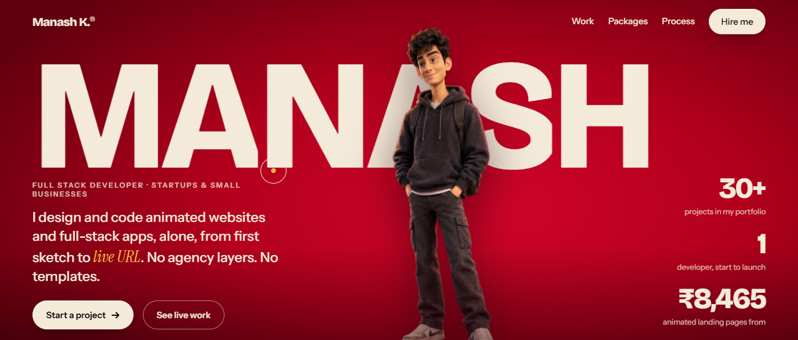
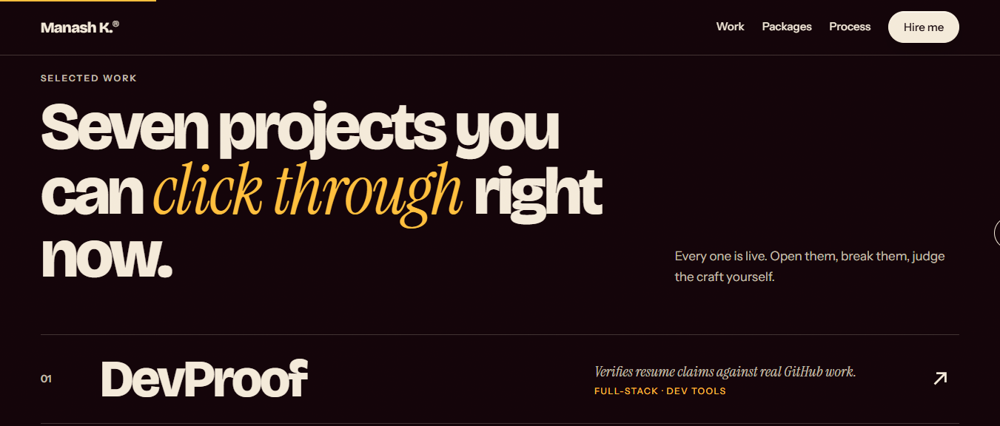
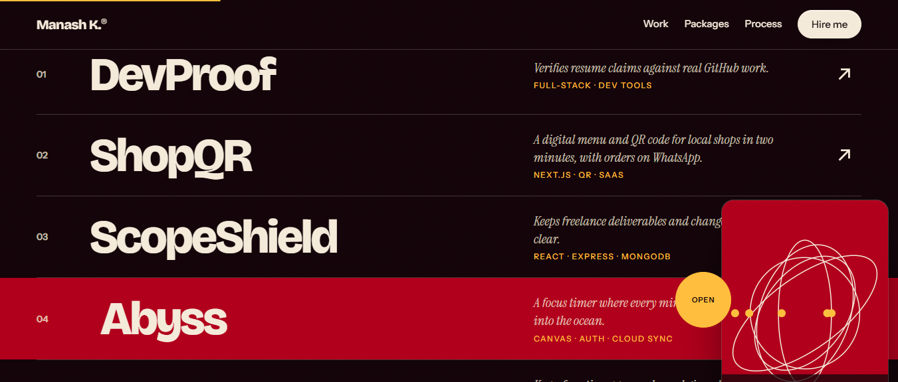
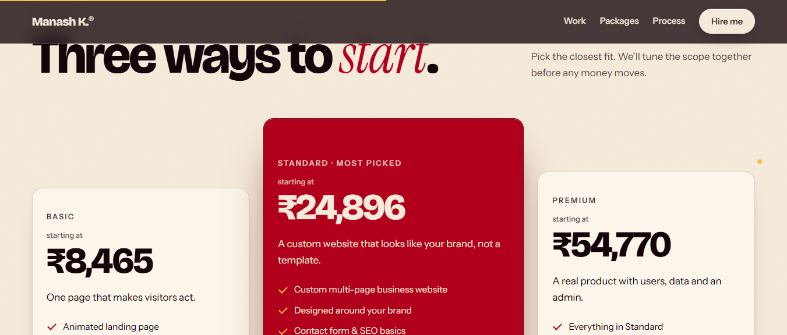
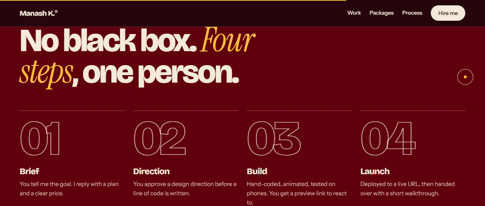
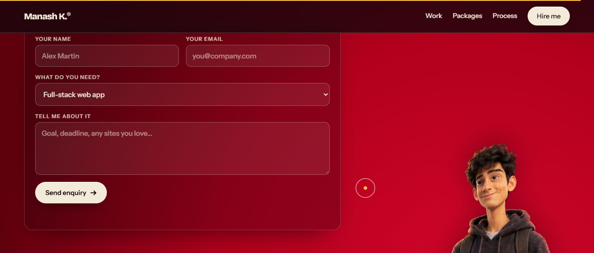

# Manash K. – Portfolio

A single-page portfolio for **Manash K.**, a full-stack developer who builds animated websites and full-stack apps for startups and small businesses. It is hand-coded in one HTML file with no framework, no build step and no template.



## Highlights

- **Living character.** A 3D-style portrait built from separate layers (body, head, face, eyes). The head turns and the pupils follow your cursor.
- **Smarter eyes in the contact section.** Snappy eye movement with tiny overshoot, micro-saccades, asymmetric blinks (sometimes double), a head tilt while you type, a wink on *Copy email* / *Send enquiry*, and "smiling" eyes when you hover a button. After a few seconds of inactivity he looks around the section and makes eye contact.
- **Selected work.** Seven live projects. Hovering a row shows a generated preview card that follows the cursor.
- **Packages.** Three clear price tiers: Basic, Standard (most picked) and Premium.
- **Process.** Four steps: Brief, Direction, Build, Launch.
- **Contact form.** Enquiries are sent straight to the owner's inbox, with a `mailto:` fallback if sending fails.
- **Details.** Custom cursor, magnetic buttons, scroll progress bar, grain overlay, scroll-reveal animations, and `prefers-reduced-motion` support.

## Screenshots

| | |
|---|---|
|  |  |
| **Selected work** | **Hover preview card** |
|  |  |
| **Packages** | **Process** |

### Contact section



## Projects featured

| Project | What it does |
|---|---|
| [DevProof](https://devproof-eight.vercel.app/) | Verifies resume claims against real GitHub work |
| [ShopQR](https://shopqr-nine.vercel.app/) | Digital menu and QR code for local shops, with orders on WhatsApp |
| [ScopeShield](https://scopeshield-pi.vercel.app/) | Keeps freelance deliverables and change requests clear |
| [Abyss](https://abyss-public.vercel.app/) | Focus timer where every minute on task takes you deeper into the ocean |
| [Pulse](https://pulse-public.vercel.app/) | Keeps free-tier apps awake and gives clients a public status page |
| [Beacon](https://beacon-psi-flame.vercel.app/) | Collect feedback, rank it by votes, ship it and tell your users |
| [Syllabus Quest](https://syllabus-quest.vercel.app/) | Turns any syllabus into a skill tree with XP, boss exams and countdowns |

## Tech

- Plain **HTML, CSS and JavaScript** in one self-contained file (`index.html`). Images are embedded, so there are no asset folders and no dependencies.
- Fonts from Google Fonts: Bricolage Grotesque, Instrument Sans and Instrument Serif. If they cannot load, system fonts are used instead.
- Contact form delivery through [FormSubmit](https://formsubmit.co) (no account needed).

## Run locally

Just open `index.html` in a browser. Or serve the folder:

```bash
npx serve .
```

## Deploy

Because it is a single static file, it works on any static host.

- **Vercel / Netlify:** drag the folder into the dashboard, or connect the repo.
- **GitHub Pages:** push to a repo and enable Pages on the main branch.

## Contact form setup (important)

The form posts to FormSubmit and delivers to `webdevmanash@gmail.com`.

1. Deploy the site to your own domain or host.
2. Submit the form once yourself.
3. FormSubmit sends a one-time confirmation email. **Click the link in it**, otherwise later enquiries will not arrive.

If sending is blocked or fails (for example offline, or on a host that restricts outside requests), the form falls back to opening the visitor's email app with the message filled in.

## Customize

Everything is in `index.html`:

| What | Where to look |
|---|---|
| Projects (name, blurb, tags, link) | the `P` array in the script near the bottom |
| Prices and package details | the `#packages` section |
| Email address | search for `webdevmanash@gmail.com` (link, copy button and form) |
| Social links | the `<footer>` |
| Colors and spacing | the CSS variables at the top of the `<style>` block |
| Eye and head behaviour | the "contact peek" script (contact section) and the "character" script (hero) |

## Accessibility

- Headings and landmarks are semantic, and the portrait has a text description.
- Animations are turned off for visitors who prefer reduced motion.
- The contact-section character is hidden below 900px width, where there is no room for it.

## Author

**Manash K.**
[GitHub](https://github.com/manashwebdev) · [LinkedIn](https://www.linkedin.com/in/manash-khati-b7a1b6385) · [Fiverr](https://www.fiverr.com/manash_in) · webdevmanash@gmail.com

© 2026 Manash K. · Built by hand, no templates.
